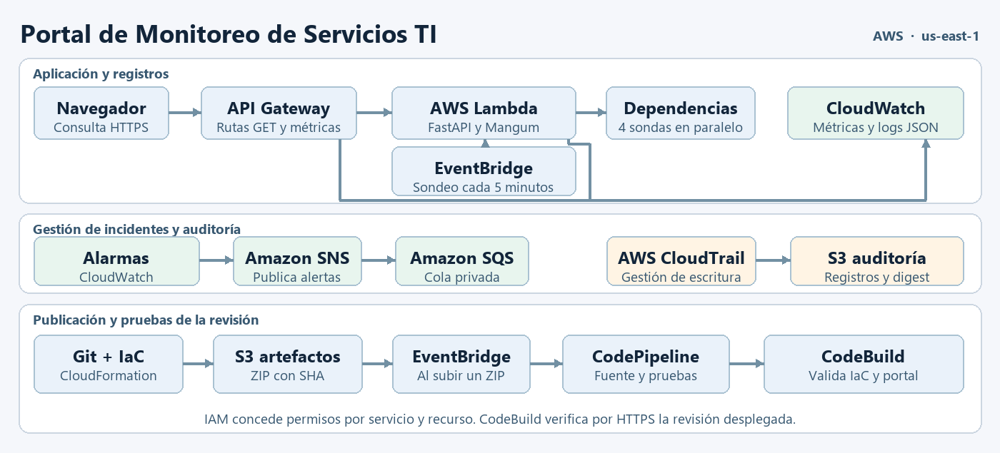

# Portal de Monitoreo de Servicios TI

**Evaluación 4 · DevOps · TILE23**
Región AWS utilizada: `us-east-1`.

El portal centraliza la disponibilidad de cuatro dependencias del equipo TI: GitHub API, PyPI, Python.org y AWS. Presenta código HTTP, latencia, hora UTC y estado. La Evaluación 4 conserva la aplicación FastAPI y agrega gestión de la configuración con CloudFormation, telemetría operativa, auditoría y validación automatizada de la versión desplegada.

## Arquitectura



API Gateway ofrece rutas GET explícitas por HTTPS. Lambda ejecuta FastAPI mediante Mangum y realiza chequeos en paralelo, por solicitud y cada cinco minutos mediante EventBridge. CloudWatch Logs registra accesos y sondas. Las alarmas envían notificaciones por SNS a una cola SQS privada. CloudTrail registra cambios de administración en un bucket separado. El ZIP del commit publicado en S3 activa CodePipeline mediante EventBridge y se valida con CodeBuild.

## Requerimientos y verificación

| ID | Requerimiento | Validación |
|---|---|---|
| T01 | /health confirma estado, versión y SHA de la revisión desplegada. | Pytest y prueba HTTPS de CodeBuild contra el manifiesto Git. |
| T02 | La interfaz y /api/services muestran cuatro chequeos, sus estados, latencia y hora UTC. | Pytest con respuestas controladas y smoke de la interfaz, CSS y API en AWS. |
| O01 | Visualizar actividad, latencia y fallos con métricas, logs y panel. | Métricas de API Gateway y Lambda, logs JSON de acceso y de sondas. E03. |
| O02 | Detectar incidentes HTTP y caídas de dependencias de forma temprana. | Tres alarmas, sondeo cada cinco minutos, historial de ALARM y mensaje en SQS. E04. |
| O03 | Reconstruir cambios administrativos en AWS. | CloudTrail multirregión, gestión de escritura, registro entregado en S3 y generación de archivos digest. E05. |
| D01 | Reproducir el entorno y ejecutar pruebas automáticamente para una revisión. | Tres stacks, artefactos versionados y ejecución S3 → EventBridge → CodePipeline → CodeBuild. E01 y E06. |
| S01 | Limitar permisos a la función de cada rol. | Políticas específicas y `AccessDenied` real al rol CodeBuild sobre el bucket de auditoría. E06–E07. |
| S02 | Usar credenciales temporales y evitar claves en el código. | Roles de servicio y comprobación de formatos de credenciales en el pipeline. E06–E07. |
| S03 | Restringir la superficie pública y proteger logs y artefactos. | Rutas GET, ausencia de URL Lambda, límites de tráfico, buckets privados con SSE, TLS y versionado. E01 y E07. |

## Ejecución

Se requiere Python 3.12, Git y AWS CLI v2. El operador de despliegue debe usar una sesión temporal AWS con permisos para administrar los tres stacks y sus servicios. Los consumidores del portal requieren un navegador.

```bash
python -m pip install -r requirements-dev.txt -r requirements-lambda.txt cfn-lint
ruff check app tests scripts/evaluacion
cfn-lint -r us-east-1 -t infra/evaluacion/*.yml
python -m pytest -q
python scripts/evaluacion/check_credentials.py
python scripts/evaluacion/release.py all --region us-east-1 --name tile23-portal
```

Para un perfil no predeterminado, agrega `--profile NOMBRE`. El subcomando `deploy` aprovisiona y `publish` vuelve a publicar el ZIP del mismo commit. Trabaja con el árbol Git limpio. Publica una revisión a la vez, tras finalizar la prueba anterior. El script fija la versión del objeto Lambda en CloudFormation y coloca el SHA de Git en la respuesta de /health y en el manifiesto de pruebas. El despliegue se hace por CloudFormation y CodeBuild valida inmediatamente el ambiente publicado. La integración temprana continúa en GitHub Actions para ramas configuradas y PR a `main`.

## Estructura

| Ruta | Contenido |
|---|---|
| `app/` | FastAPI, interfaz, estilos y adaptador Lambda |
| `infra/evaluacion/` | Stacks de artefactos, portal y pipeline |
| `buildspec.yml` | Ruff, cfn-lint, pytest, comprobación de claves y pruebas del portal desplegado |
| `tests/` | Casos unitarios y de contrato ASGI |
| `scripts/evaluacion/` | Despliegue/publicación, verificaciones y demostración de alarma |
| `docs/evaluacion/` | Informe, arquitectura, video y evidencias |
| `infra/cloudformation.yml` | Plantilla EC2 de la Evaluación 3 para referencia histórica |

## Evidencias y video

- [Índice de evidencias](docs/evaluacion/evidencias/README.md)
- [Video de demostración (MP4, 3 min 28 s)](docs/evaluacion/Demostracion-Evaluacion-4.mp4)
- [Informe técnico en PDF](docs/evaluacion/Informe-Evaluacion-4.pdf)

Esta rama reúne las versiones públicas del informe y la demostración. El paquete de evaluación contiene las capturas de la consola y los registros de AWS para la revisión docente. Las pruebas en AWS validaron la revisión de código `e880a7d`.

### Retiro del entorno al terminar la revisión

Elimina los stacks de pipeline, portal y artefactos, en ese orden y esperando la finalización de cada uno. Los dos buckets se retienen para conservar los artefactos y registros. Verifica la copia de la evidencia y la política de retención antes de decidir su eliminación. El stack original de la Evaluación 3 se administra por separado.
